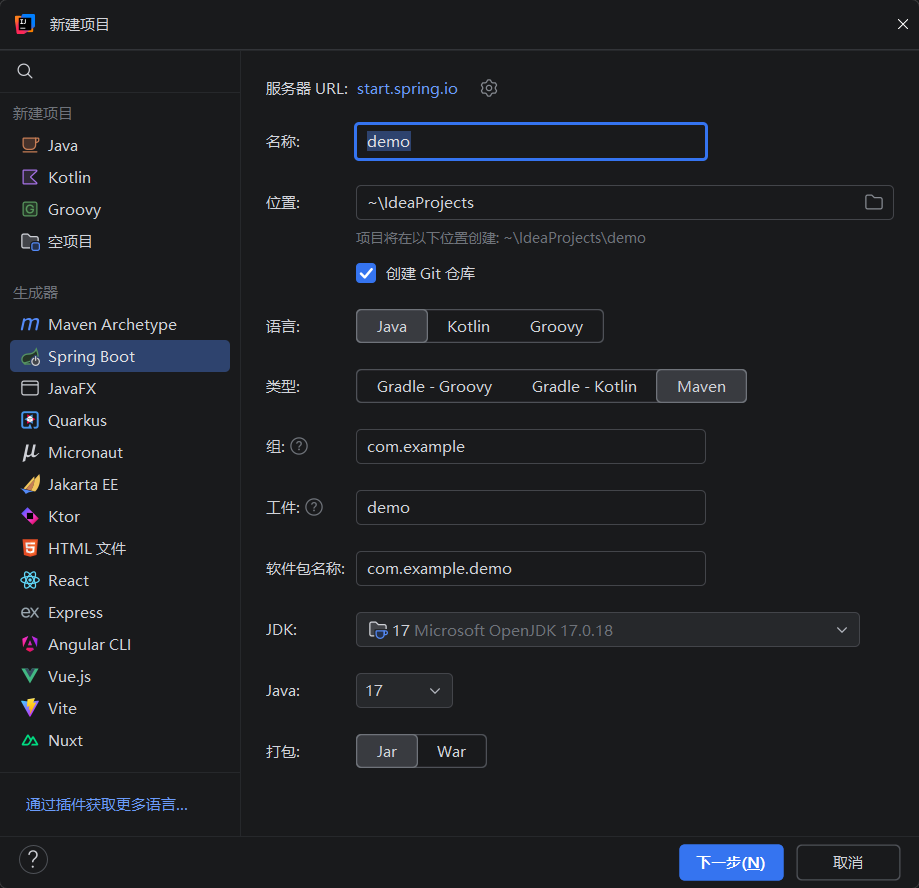
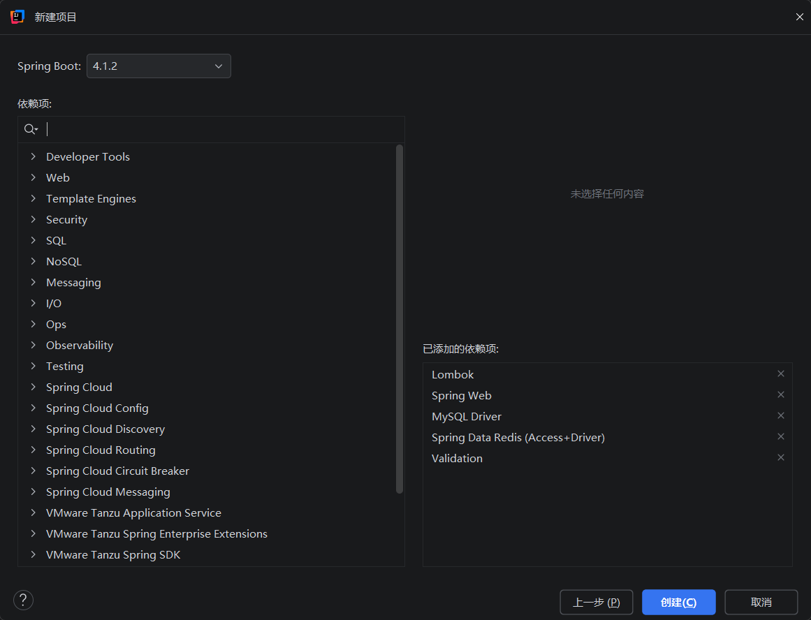

# SpringBoot 项目常用依赖

通过 idea 创建一个 springboot 项目：



这时可以选择一些初始依赖：



在这里没有的依赖可以在后续的mavan中添加。

| 依赖名称 | 核心作用 | 常用注解 / 核心组件 |
| :-- | :-- | :-- |
| **Lombok** | 通过注解在编译期自动生成代码（如 Getter/Setter、构造器、日志等），减少样板代码。 | `@Data`<br>`@NoArgsConstructor`<br>`@AllArgsConstructor`<br>`@Slf4j` |
| **Spring Web** | 提供 Web 开发的基础支持，内置 Tomcat 服务器，处理 HTTP 请求。 | `@RestController`<br>`@RequestMapping`<br>`@GetMapping`<br>`@RequestBody` |
| **Mysql Driver** | Java 连接 MySQL 数据库的底层通信组件。 | 无（纯底层依赖） |
| **Spring Data Redis** | 提供对 Redis 的集成访问，包含连接池（Lettuce/Jedis）。 | `RedisTemplate`<br>`StringRedisTemplate` |
| **Validation** | 提供 JSR-380 标准的参数校验功能，用于拦截不合法数据。 | `@Validated`<br>`@NotNull`<br>`@NotBlank`<br>`@Size`<br>`@Email` |
| **Spring Security** | Spring 官方强大的安全框架，负责认证（Authentication）和授权（Authorization）。 | `SecurityFilterChain`<br>`@PreAuthorize` |
| **MyBatis-Plus** | MyBatis 的增强工具，简化了单表 CRUD 操作，自带代码生成器和分页插件。 | `@TableName`<br>`@TableId`<br>`@TableField`<br>`BaseMapper<T>` |
| **JWT 令牌** | 跨域认证的令牌标准。这里引入的通常是 `jjwt` 或 `java-jwt` 库。 | `Jwts.builder()`<br>`Jwts.parser()` |
| **Knife4j** | 基于 OpenAPI3 的接口文档增强 UI 工具，自动扫描并生成可视化网页。 | `@Tag`<br>`@Operation`<br>`@Schema` |

## Lombok - 代码生成器

`Lombok` 本质上是一个编译期插件。

### 没有 Lombok 之前

假设你有一个用户实体类 `User`，里面有 5 个字段（id, username, password, age, email）。按照 Java 的规范，你必须手写：

- 5 个字段的 `getter` 和 `setter` 方法（大约 50 行代码）。
- 一个无参构造方法。
- 一个全参构造方法。
- `toString()` 方法（方便打印日志）。
- `equals()` 和 `hashCode()` 方法。

结果你的类变成了这样（全是废话）：

```java
public class User {
    private Long id;
    private String username;
    // ... 其他字段

    public Long getId() { return id; }
    public void setId(Long id) { this.id = id; }
    public String getUsername() { return username; }
    public void setUsername(String username) { this.username = username; }
    // ... 几十行 getter/setter
}
```

### 有了 Lombok 之后

你只需要在类名上面加一行 `@Data` 注解，刚才那几十行代码就在编译时自动生成了。你的代码可以精简成这样：

```java
import lombok.Data;

@Data
public class User {
    private Long id;
    private String username;
    private String password;
    private Integer age;
}
```

代码瞬间清爽了，重点全在字段上！

### 最常用的 Lombok 注解

1. `@Data`（最常用）：一键生成所有字段的 `getter`、`setter`、`toString()`、`equals()` 和 `hashCode()`。
2. `@NoArgsConstructor`：自动生成无参构造方法（很多框架如 MyBatis、Spring 反射创建对象时必须有这个）。
3. `@AllArgsConstructor`：自动生成包含所有字段的带参构造方法。
4. `@Slf4j`：自动在类里注入一个日志对象。你不需要写 `private static final Logger log = LoggerFactory.getLogger(...)`，直接在代码里写 `log.info("保存用户成功")` 就可以了。
5. `@Builder`：让对象支持链式创建（比如 `User.builder().name("张三").age(18).build()`），这在创建包含大量字段的对象时非常优雅。

## Spring Web - 基石

`Spring Web` 是构建 Spring Boot Web 应用（包括前后端分离的 RESTful API 和传统网页）最核心的基石依赖。

### 自带“内嵌服务器”（不用再配 Tomcat）

在传统的 Java Web 开发中，你需要单独下载一个 Tomcat 软件，配置好路径，把代码打包丢进去运行。引入 `Spring Web` 后，它内置了一个 Tomcat 服务器。你只需点击 IDEA 里的绿色运行按钮，服务器就在后台启动了，前端就能通过 `http://localhost:8080` 访问你的接口。

### 提供 Web 注解（帮你接收前端请求）

你平时写的那些控制器注解（如 `@RestController`、`@GetMapping`、`@PostMapping`、`@RequestMapping`），全都是 `Spring Web` 提供的。

前端发来一个 `POST /api/posts` 的请求，`Spring Web` 会精准地把它路由到你写好的 Java 方法里，并把前端传过来的 JSON 数据解析成 Java 对象。

### 自动转换 JSON（前后端沟通的桥梁）

在前后端分离的项目中，前端需要的是 JSON 数据，而不是复杂的 Java 对象。

`Spring Web` 内置了 Jackson 库。当你从数据库查出数据后，直接 `return user;`，它会自动帮你把 Java 对象转换成像 `{"id": 1, "username": "admin"}` 这样的 JSON 字符串发给前端。

## Mysql Driver - 数据库驱动程序

`MySQL Driver` 是 Spring Boot 项目连接 MySQL 数据库的“官方驱动程序”。主要为以下作用：

1. `提供通信协议`：它把 Java 代码里的 SQL 语句，翻译成 MySQL 数据库能听懂的底层网络协议。
2. `建立连接`：根据你写在 `application.properties` 里的 URL、用户名和密码，帮你在 Java 和数据库之间建立 TCP 连接。
3. `管理连接池`：配合 Spring Boot 内置的 HikariCP 连接池，高效地管理这些连接（用完不马上销毁，留着给下一次用，提升性能）。

## Spring Data Redis (Access+Driver)

`Spring Data Redis (Access+Driver)` 是 `Spring Boot` 帮你操作 Redis 数据库的集成依赖。

- `Access (访问)`：指的是 `Spring Data Redis` 这层框架。它像是一个翻译官，让你不用写原生的 Redis 命令，直接用 Java 对象和方法就能操作（比如 `redisTemplate.opsForValue().set()`）。
- `Driver (驱动)`：指的是底层的 Redis 客户端。Spring Boot 默认使用的是 `Lettuce`（也有 Jedis，但 Lettuce 性能更好，且基于 Netty 支持异步）。

在使用前需要注意：

1. 必须启动 Redis 服务：光引入这个依赖还不够，你电脑上必须安装了 Redis（或者在 Docker 里跑一个），并在 `application.properties` 里配置好连接地址：

```properties
spring.data.redis.host=localhost
spring.data.redis.port=6379
spring.data.redis.password=你的密码(如果没有就不写)
```

2. 自动注入：引入这个依赖后，Spring Boot 会自动帮你配置好 `RedisTemplate` 和 `StringRedisTemplate`。你在 Service 类里直接 `@Autowired` 注入，就能开箱即用，不需要自己写连接池代码。

## Validation - 参数校验

`Validation` 是 Spring Boot 中用来做参数校验的核心依赖。

简单来说，它的作用是：在请求真正进入你的业务代码（Service）之前，把那些不合规的数据直接“拦在门外”。

### 没有 Validation 之前

假设前端发来了一个注册请求：`username="", password="123"`。如果没有 Validation，你得在 Controller 或 Service 里写一大堆 `if-else`：

```java
if (user.getUsername() == null || user.getUsername().isEmpty()) {
    throw new RuntimeException("用户名不能为空");
}
if (user.getPassword().length() < 6) {
    throw new RuntimeException("密码长度不能少于6位");
}
// ... 还有手机号、邮箱格式等等，代码又臭又长
```

### 有了 Validation 之后

你只需要在接收参数的实体类（DTO）上，加上几个注解：

```java
@Data
public class UserRegisterDTO {

    @NotBlank(message = "用户名不能为空")
    private String username;

    @Size(min = 6, max = 20, message = "密码长度必须在6到20位之间")
    private String password;

    @Email(message = "邮箱格式不正确")
    private String email;
}
```

然后在 Controller 的方法参数前加上 `@Valid` 或 `@Validated` 注解：

```java
@PostMapping("/register")
public Result register(@Valid @RequestBody UserRegisterDTO dto) {
    // 只要代码能走到这里，说明 dto 里的数据绝对都是合规的！
    userService.register(dto);
    return Result.success();
}
```

如果前端传的数据不符合要求，Spring Boot 会直接抛出异常，根本不会执行你后面的业务代码，为你省去了无数个 `if` 判断。

---

### 最常用的 4 个校验注解

1.  `@NotNull`：不能为 `null`（通常用于 Integer、Long 等包装类）。
2.  `@NotBlank`：不能为 `null`，且去除首尾空格后长度必须大于 0（专门用于 String）。
3.  `@Size(min=, max=)`：校验字符串长度，或集合大小。
4.  `@Email`：校验是否是合法的邮箱格式。

> 此外还有 `@Min`, `@Max`, `@Pattern`(正则校验手机号) 等等

### 全局异常处理

校验失败时，Spring 默认返回的错误信息是一大坨很难看的英文异常堆栈。在实际项目中，我们通常会配合 `@RestControllerAdvice` 和 `@ExceptionHandler(MethodArgumentNotValidException.class)` 写一个全局异常处理器，把错误信息提取出来，变成 `{ "code": 400, "msg": "用户名不能为空" }` 这样友好的 JSON 格式返回给前端。

## Spring Security - 安全

`Spring Security` 是 Spring 家族中负责安全认证与权限控制的核心框架。

我们来通俗地理解一下它是干嘛的：

### 两大核心使命

1. `认证（Authentication）——你是谁？`：当用户请求接口时，`Spring Security` 会拦截请求，检查你有没有携带有效的 Token（或 Session）。如果没带，或者 Token 过期了，它会直接打回，返回 `401 Unauthorized`（未授权）。如果带了，它会解析出你是谁（比如用户 ID 是 1 的张伟）。
2. `授权（Authorization）——你能干什么？`：验证完你是谁之后，它还要检查你有没有权限干这件事。比如：普通用户只能“点赞、评论”，但“删除违规笔记”这个接口，只有 `role="ADMIN"`（管理员）才能调用。如果普通用户硬调，它会返回 `403 Forbidden`（禁止访问）。

> > 只要你在 `pom.xml` 里引入了它，Spring Security 也会立刻生效，你的所有接口都会被拦截。

## MyBatis-Plus

`MyBatis-Plus` 是 `MyBatis` 的增强工具，它在 `MyBatis` 的基础上只做增强不做改变，旨在简化开发、提高效率。

### MyBatis-Plus 核心作用

- 无 SQL 单表 CRUD：只要让 Mapper 接口继承 `BaseMapper<T>`，Service 层继承 `IService<T>` 和 `ServiceImpl`，你不需要写任何 XML 或 SQL，就能直接调用 `insert`、`deleteById`、`updateById`、`selectList` 等方法。
- 强大的条件构造器（Wrapper）：用于构建复杂的 `WHERE` 条件。例如 `new QueryWrapper<User>().like("username", "张").eq("status", 1)`，完全用 Java 代码代替 SQL 拼接，且天然防 SQL 注入。
- 自动填充：通过实现 `MetaObjectHandler` 接口，可以在插入或更新时自动填充 `create_time` 和 `update_time` 等公共字段，无需在每次业务代码中手动 `set`。
- 逻辑删除：只需在实体类的字段上加 `@TableLogic`，并在配置中指定删除值和未删除值，调用 `deleteById` 时就会自动将数据标记为已删除（如 `UPDATE ... SET deleted = 1`），而不是物理删除。

---

### 分页插件（PaginationInnerInterceptor）

MyBatis-Plus 的分页功能依赖于拦截器实现，它会自动拦截你的查询请求，并拼接 `LIMIT` 和 `COUNT` 语句。

> > 从 MyBatis-Plus 3.5.9 版本开始，分页插件被拆分到了单独的模块 `mybatis-plus-jsqlparser` 中。

标准配置方式，新建 `MybatisPlusConfig`:

```java
package com.example.sparkle.config;

import com.baomidou.mybatisplus.annotation.DbType;
import com.baomidou.mybatisplus.extension.plugins.MybatisPlusInterceptor;
import com.baomidou.mybatisplus.extension.plugins.inner.PaginationInnerInterceptor;
import org.springframework.context.annotation.Bean;
import org.springframework.context.annotation.Configuration;

@Configuration
public class MybatisPlusConfig {

    @Bean
    public MybatisPlusInterceptor mybatisPlusInterceptor() {
        MybatisPlusInterceptor interceptor = new MybatisPlusInterceptor();
        // 添加分页插件，并指定数据库类型为 MySQL
        interceptor.addInnerInterceptor(new PaginationInnerInterceptor(DbType.MYSQL));
        return interceptor;
    }
}
```

分页使用示例：

```java
// 查询第 1 页，每页 10 条数据
Page<Note> page = new Page<>(1, 10);
// 可以带上查询条件，比如按用户 ID 过滤
QueryWrapper<Note> wrapper = new QueryWrapper<>();
wrapper.eq("user_id", 1L);

// 执行分页查询，MP 会自动拼接 LIMIT 并返回总数
Page<Note> result = noteMapper.selectPage(page, wrapper);

// 获取结果
List<Note> records = result.getRecords(); // 当前页数据
long total = result.getTotal();           // 总条数
long pages = result.getPages();           // 总页数
```

## JWT 令牌

JWT（JSON Web Token）是目前前后端分离项目中最主流的`无状态登录凭证`方案。在项目中，用户登录成功后，后端会生成一个 JWT 返回给前端，前端后续每次请求都在请求头中带上它，后端通过校验这个令牌来确认用户身份。

一个标准的 JWT 长这样：`xxxxx.yyyyy.zzzzz`，由三部分组成，用 `.` 隔开：

1.  `Header（头部）`：说明令牌类型（JWT）和签名算法（如 HS256）。经 Base64 编码。
2.  `Payload（负载）`：存放实际数据（称为 Claims，声明）。可以放用户的 ID、用户名、过期时间（`exp`）等。
3.  `Signature（签名）`：使用 Header 里的算法和只有服务器知道的密钥（Secret），对前两部分进行加密计算得出。它保证了 Token 不能被篡改。如果前端改了 Payload 里的用户 ID 想冒充别人，服务端验签时会直接失败。

### 标准代码实现（适配 Spring Boot 4 / JJWT 0.11.5）

你 `pom.xml` 里已经引入了 `jjwt-api`、`jjwt-impl`、`jjwt-jackson` 0.11.5 版本，可以直接用。

JwtUtil 工具类：

```java
package com.example.sparkle.util;

import io.jsonwebtoken.Claims;
import io.jsonwebtoken.Jwts;
import io.jsonwebtoken.SignatureAlgorithm;
import io.jsonwebtoken.security.Keys;
import org.springframework.beans.factory.annotation.Value;
import org.springframework.stereotype.Component;

import java.nio.charset.StandardCharsets;
import java.util.Date;

@Component
public class JwtUtil {

    // 建议在 application.yaml 中配置一个足够长的随机字符串
    @Value("${jwt.secret:SparkleSecretKeySparkleSecretKeySparkleSecretKey}")
    private String secret;

    // 过期时间，毫秒，默认 24 小时
    @Value("${jwt.expiration:86400000}")
    private Long expiration;

    // 生成 Token
    public String generateToken(Long userId, String username) {
        return Jwts.builder()
                .setSubject(username)                               // 主题（用户名）
                .claim("userId", userId)                            // 自定义声明（用户ID）
                .setIssuedAt(new Date())                            // 签发时间
                .setExpiration(new Date(System.currentTimeMillis() + expiration)) // 过期时间
                .signWith(Keys.hmacShaKeyFor(secret.getBytes(StandardCharsets.UTF_8)), SignatureAlgorithm.HS256)
                .compact();
    }

    // 解析 Token，获取所有 Claims
    public Claims getClaimsFromToken(String token) {
        return Jwts.parserBuilder()
                .setSigningKey(Keys.hmacShaKeyFor(secret.getBytes(StandardCharsets.UTF_8)))
                .build()
                .parseClaimsJws(token)
                .getBody();
    }

    // 获取用户名
    public String getUsernameFromToken(String token) {
        return getClaimsFromToken(token).getSubject();
    }

    // 获取用户 ID
    public Long getUserIdFromToken(String token) {
        return getClaimsFromToken(token).get("userId", Long.class);
    }

    // 判断是否过期
    public boolean isTokenExpired(String token) {
        try {
            return getClaimsFromToken(token).getExpiration().before(new Date());
        } catch (Exception e) {
            return true;
        }
    }
}
```

在 `application.yaml` 中配置：

```yaml
jwt:
  # 密钥长度必须够长（HS256 要求至少 256 位），否则启动会报错
  secret: SparkleSecretKeySparkleSecretKeySparkleSecretKey
  expiration: 86400000 # 24小时
```

### 相关问题

1. `密钥长度`：HS256 算法要求密钥至少 32 个字节（256 位）。如果你随便写个 `"123456"`，启动时会直接报 `WeakKeyException`，必须写长一点。
2. `Token 注销（登出）`：JWT 是无状态的，签发后除非过期，否则无法“作废”。如果用户点了“退出登录”，前端只要把本地的 Token 删掉即可。但如果用户 Token 被盗，非常危险。**解决方案**：在 Redis 中存一个“黑名单”，用户登出时把 Token 丢进 Redis 并设置过期时间（与 Token 剩余有效期一致），过滤器里先查黑名单。
3. `Token 续期`：如果 Token 设 24 小时，用户 24 小时后突然被踢出，体验很差。主流方案是“双 Token”：一个短期 AccessToken（如 2 小时），一个长期 RefreshToken（如 7 天）。AccessToken 过期后，前端拿 RefreshToken 悄悄去换新的。
4. `Knife4j 调试`：在 Knife4j 页面右上角有个 “Authorize” 按钮，把你的 Token 填进去，之后所有请求就会自动带上，不用每次手动填。

## Knife4j 接口文档

`Knife4j` 是一个为 Java Spring 项目提供增强版 Swagger/OpenAPI 接口文档界面的解决方案。

配置（`application.yml`）的核心目的是告诉 `Knife4j` 去扫描哪个包，以及开启增强功能。。

```yaml
springdoc:
  api-docs:
    path: /v3/api-docs
  group-configs:
    - group: default
      paths-to-match: /**
      packages-to-scan: com.你的项目.controller包路径 # 必须改成实际路径

knife4j:
  enable: true # 开启增强（排序、导出等功能依赖此开关）
  setting:
    language: zh_cn # 界面中文
```

> 如果不需要分组，也可以只用最简配置：`springdoc.packages-to-scan` 加上 `knife4j.enable: true` 即可。

启动项目后，访问 `http://localhost:8080/doc.html` 即可看到界面。但要让接口正常显示，Controller 上需要加 OpenAPI 3 标准注解（不是旧的 `@Api`）。

1. Controller 类上：

```java
@Tag(name = "用户管理")  // 替代旧版 @Api
@RestController
public class UserController {}
```

2. 方法上：

```java
@Operation(summary = "获取用户信息")  // 替代旧版 @ApiOperation
@GetMapping("/user/{id}")
public User getUser(@Parameter(description = "用户ID") @PathVariable Long id) {
    ...
}
```

3. 实体类上:

```java
@Schema(description = "用户信息")
public class User {
    // ...
}
```

> > 上线前，务必在配置文件里设置 `knife4j.production: true` 或直接 `knife4j.enable: false`，避免接口文档在公网暴露。
